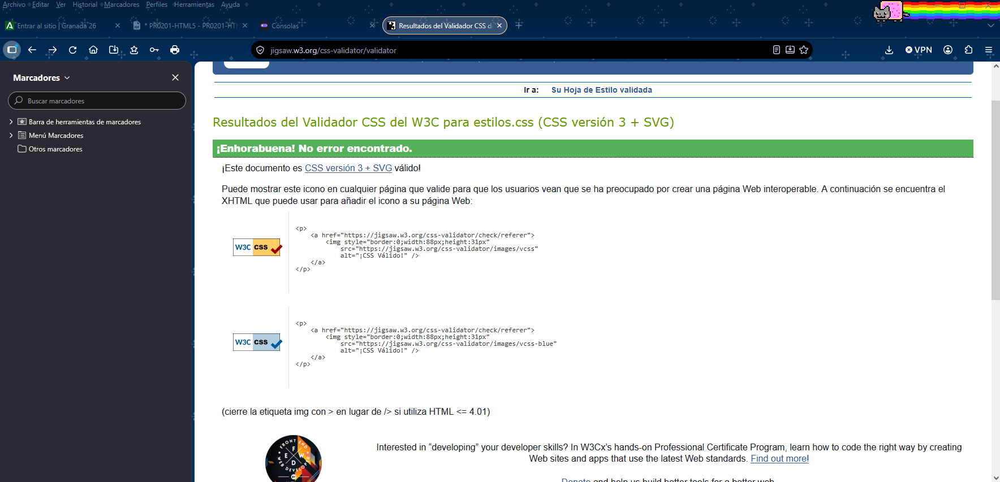
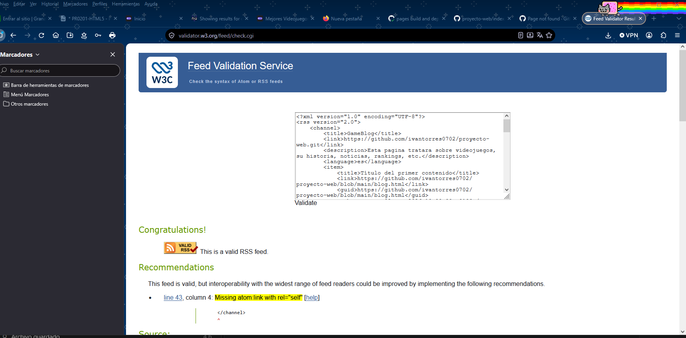

# BIOTECNOLOGIA INDUSTRIAL
Esta web tratará sobre el surgimiento y evolucion de la biotecnologia industrial.
## Autoría
- Nombre y apellidos: Iván Torres Salas
- Curso: 1ºDAM A
- Módulo: Lenguaje de marcas
- Fecha: 
## Sitio publicado
- Web en GitHub Pages: [Abrir sitio](URL-DE-GITHUB-PAGES)
- Repositorio: [Abrir repositorio](URL-DEL-REPOSITORIO)
## Estructura del proyecto
- `index.html`: descripción de la página principal.
- `blog.html`: descripción del artículo.
- `tabla.html`: descripción de la información tabular.
- `galeria.html`: descripción de la galería y los recursos multimedia.
- `formulario.html`: descripción del formulario.
- `rss.xml`: descripción del canal RSS.
- `css/estilos.css`: estilos básicos compartidos.
## Tecnologías utilizadas
- HTML5
- CSS
- XML y RSS
- Git
LMSGI UD 2. HTML 5
- GitHub
- GitHub Pages
## Características principales
- Navegación entre cinco páginas.
- Uso de HTML semántico.
- Tabla accesible.
- Galería con varios formatos.
- Contenido multimedia.
- Formulario con validación HTML.
- Canal RSS.
## Validación
### HTML

### CSS

### RSS

## Dificultades encontradas
Describe al menos tres dificultades reales:
1. El navegador estaba mal y tuve que arreglarlo en todas las paginas
2. Al intentar agrupar por categorias la tabla el tfoot no se ajustaba a la tabla devido a los rowspan y tuve que colocar una celda vacia en el tfoot
3. No se visualizaba el video de youtube por lo que tuve que cambiar la url y sustituir una parte por /embed/
LMSGI UD 2. HTML 5
## Decisiones técnicas
Explica brevemente:
- Cómo has organizado los archivos.
- Qué partes de la plantilla se repiten.
- Qué cambia en cada página.
- Por qué has elegido determinados formatos de imagen.
- Cómo has utilizado rutas relativas.
- Cómo has preparado el proyecto para la siguiente práctica de CSS.
## Fuentes y licencias